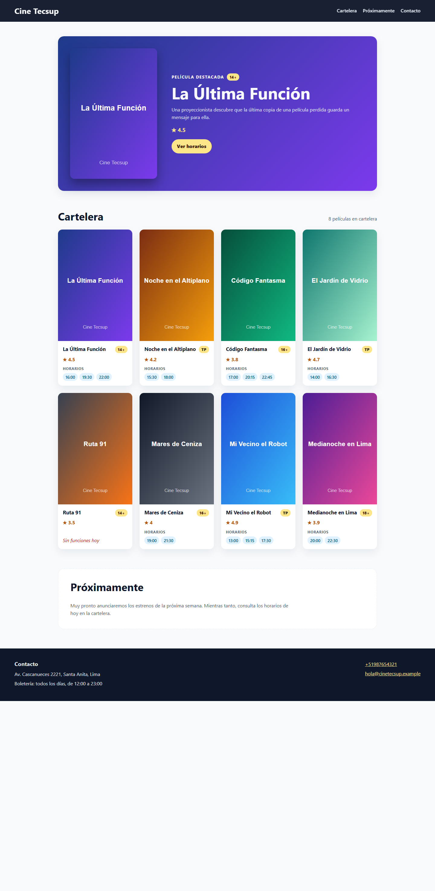
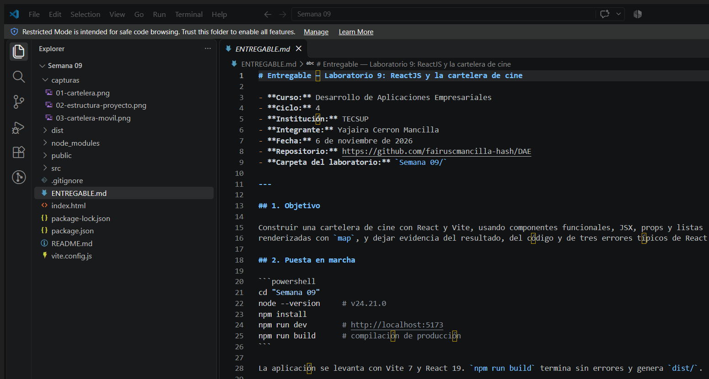

# Entregable — Laboratorio 9: ReactJS y la cartelera de cine

- **Curso:** Desarrollo de Aplicaciones Empresariales
- **Ciclo:** 4
- **Institución:** TECSUP
- **Integrante:** Yajaira Cerron Mancilla
- **Fecha:** 6 de noviembre de 2026
- **Repositorio:** https://github.com/fairuscmancilla-hash/DAE
- **Carpeta del laboratorio:** `Semana 09/`

---

## 1. Objetivo

Construir una cartelera de cine con React y Vite, usando componentes funcionales, JSX, props y listas
renderizadas con `map`, y dejar evidencia del resultado, del código y de tres errores típicos de React.

## 2. Puesta en marcha

```powershell
cd "Semana 09"
node --version     # v24.21.0
npm install
npm run dev        # http://localhost:5173
npm run build      # compilación de producción
```

La aplicación se levanta con Vite 7 y React 19. `npm run build` termina sin errores y genera `dist/`.

## 3. Estructura del proyecto

```text
Semana 09/
├─ capturas/
│  ├─ 01-cartelera.png
│  ├─ 02-estructura-proyecto.png
│  └─ 03-cartelera-movil.png
├─ public/
│  └─ posters/
│     ├─ 1.svg ... 8.svg
├─ src/
│  ├─ components/
│  │  ├─ Header.jsx
│  │  ├─ Footer.jsx
│  │  ├─ Hero.jsx
│  │  ├─ MovieCard.jsx
│  │  ├─ MovieList.jsx
│  │  └─ index.js
│  ├─ data/
│  │  └─ movies.js
│  ├─ styles/
│  │  ├─ base.css
│  │  ├─ layout.css
│  │  └─ components.css
│  ├─ App.jsx
│  └─ main.jsx
├─ index.html
├─ package.json
├─ vite.config.js
├─ README.md
└─ ENTREGABLE.md
```

La estructura del proyecto en el editor se muestra en `capturas/02-estructura-proyecto.png`.

## 4. Datos de la cartelera

`src/data/movies.js` contiene **ocho películas**. Cada objeto incluye los seis campos que pide la guía:
`title`, `image`, `synopsis`, `classification`, `rating` y `showtimes`.

| # | Película | Clasificación | Valoración | Horarios |
|---|---|---|---|---|
| 1 | La Última Función | 14+ | 4.5 | 16:00, 19:30, 22:00 |
| 2 | Noche en el Altiplano | TP | 4.2 | 15:30, 18:00 |
| 3 | Código Fantasma | 16+ | 3.8 | 17:00, 20:15, 22:45 |
| 4 | El Jardín de Vidrio | TP | 4.7 | 14:00, 16:30 |
| 5 | Ruta 91 | 14+ | 3.5 | **Sin funciones hoy** |
| 6 | Mares de Ceniza | 16+ | 4.0 | 19:00, 21:30 |
| 7 | Mi Vecino el Robot | TP | 4.9 | 13:00, 15:15, 17:30 |
| 8 | Medianoche en Lima | 18+ | 3.9 | 20:00, 22:30 |

La película 5 se dejó sin horarios a propósito para comprobar el caso vacío.

## 5. Componentes y props

| Componente | Archivo | Props | Qué hace |
|---|---|---|---|
| `Header` | `src/components/Header.jsx` | `name`, `links` | Muestra el nombre del cine en un `<h1>` y la navegación principal con un `<li>` por enlace |
| `Footer` | `src/components/Footer.jsx` | `contact` | Muestra dirección, horario, teléfono (`tel:`) y correo (`mailto:`) |
| `Hero` | `src/components/Hero.jsx` | `movie` | Banner de la película destacada: afiche, título, sinopsis, clasificación, valoración y enlace a sus horarios |
| `MovieCard` | `src/components/MovieCard.jsx` | `movie` | `<article>` con afiche, título, clasificación, valoración y horarios; si no hay funciones muestra el mensaje correspondiente |
| `MovieList` | `src/components/MovieList.jsx` | `movies` | Recorre el arreglo con `map` y envuelve cada tarjeta en un `<li key={movie.id}>` |

Los hijos no conocen el arreglo completo: reciben solo la película o el contacto que necesitan. `App.jsx`
es el único que importa los datos y los reparte.

## 6. Composición en `App.jsx`

```jsx
<Header name="Cine Tecsup" links={links} />
<main>
  <Hero movie={featured} />
  <section id="cartelera">
    <h2>Cartelera</h2>
    <MovieList movies={movies} />
  </section>
  <section id="proximamente">...</section>
</main>
<Footer contact={contact} />
```

La navegación del `Header` apunta a `#cartelera`, `#proximamente` y `#contacto`. El enlace «Ver horarios»
del `Hero` apunta a `#horarios-1`, el `id` de la tarjeta de la película destacada.

## 7. Los tres errores típicos provocados

### Error 1 — Usar `class` en vez de `className`

Se cambió temporalmente `<header className="site-header">` por `<header class="site-header">`.
La consola del navegador mostró:

```text
Invalid DOM property `class`. Did you mean `className`?
```

**Causa:** en JSX los atributos usan los nombres de las props de React, no los del HTML. `class` es una
palabra reservada de JavaScript; por eso React usa `className`.
**Corrección:** volver a `className="site-header"`.

### Error 2 — Devolver dos nodos raíz

Se creó temporalmente un componente que devolvía dos `<h2>` sin un elemento padre:

```jsx
return (
  <h2>Primer nodo raíz</h2>
  <h2>Segundo nodo raíz</h2>
);
```

`npm run build` falló con:

```text
error during build:
[vite:esbuild] Transform failed with 1 error:
src/TwoRootsDemo.jsx:4:16: ERROR: Expected ")" but found "nodo"
```

**Causa:** un componente debe devolver **un solo** nodo raíz; dos elementos hermanos no forman una
expresión JSX válida. Vite lo detecta al transformar el archivo (el mensaje clásico de React/Babel es
«Adjacent JSX elements must be wrapped in an enclosing tag»).
**Corrección:** envolver los dos elementos en un fragmento `<>...</>` o en un `<div>`.

### Error 3 — Olvidar la `key` en un `map`

Se quitó temporalmente `key={movie.id}` del `<li>` de `MovieList`. La consola mostró:

```text
Each child in a list should have a unique "key" prop.
Check the render method of `MovieList`.
```

**Causa:** React necesita una identidad estable para cada elemento de una lista. Sin `key`, al reordenar
o eliminar elementos puede reutilizar nodos equivocados.
**Corrección:** usar `key={movie.id}`, no el índice.

Los tres cambios se revirtieron: el código final compila y no muestra avisos en la consola.

## 8. Capturas

### Resultado en el navegador



### Estructura del proyecto en el editor



### Vista móvil (420 px)


## 9. Casos de prueba manuales

| Caso | Resultado esperado | Resultado |
|---|---|---|
| Cargar la página | Hero destacado y ocho tarjetas | ✅ |
| Película sin horarios (Ruta 91) | Mensaje «Sin funciones hoy» y ninguna lista de horas | ✅ |
| Navegación «Cartelera» / «Próximamente» / «Contacto» | Desplazamiento a la sección correspondiente | ✅ |
| Enlace «Ver horarios» del Hero | Desplazamiento a la tarjeta de la película 1 | ✅ |
| Consola del navegador | Sin errores ni advertencias de React | ✅ |
| `npm run build` | Compilación correcta en `dist/` | ✅ |
| Vista móvil (≤ 640 px) | Hero en una columna y tarjetas apiladas | ✅ |

## 10. Evaluación según la rúbrica

| Criterio | Puntos | Evidencia |
|---|---|---|
| 1. Crea el proyecto con Vite y lo levanta | 5/5 | `npm run dev` y `npm run build` funcionan; Node v24.21.0 |
| 2. Componentes funcionales con JSX compuestos | 5/5 | Cinco componentes con una responsabilidad cada uno, compuestos en `App.jsx` |
| 3. Props del padre a los hijos | 5/5 | `Header`, `Footer`, `Hero`, `MovieCard` y `MovieList` reciben solo los datos que usan |
| 4. Repositorio con interfaz y observaciones | 5/5 | Código, README, capturas, informe y evidencia de los tres errores |

## 11. Conclusiones

- Separar la interfaz en componentes pequeños hace que cada archivo tenga una responsabilidad clara y
  que los datos viajen en una sola dirección: `App` → componentes → JSX.
- Las props permiten reutilizar `MovieCard` con ocho películas distintas sin duplicar código; `MovieList`
  solo se encarga de recorrer el arreglo y de asignar una `key` estable.
- Los tres errores reproducidos muestran que React avisa en la consola (`class`, `key`) o falla al
  compilar (dos nodos raíz). Leer esos mensajes es más rápido que adivinar la causa.
- El caso de «Ruta 91» sin horarios obliga a pensar en los estados vacíos, no solo en el camino feliz.
