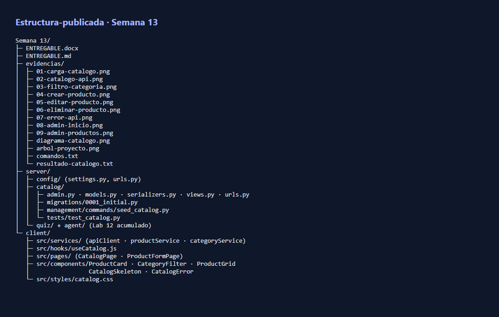
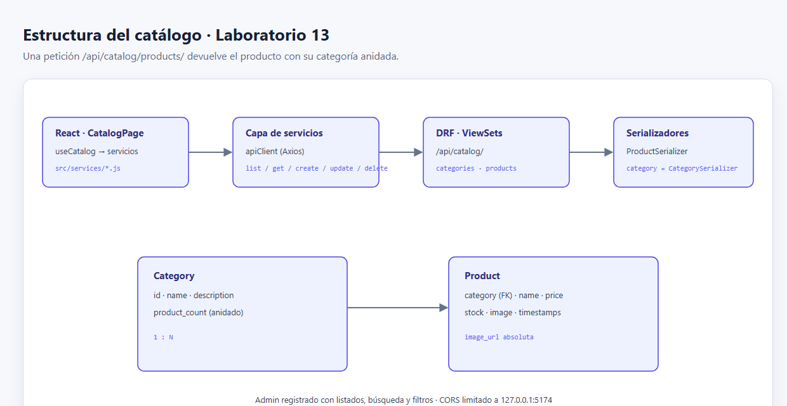

# Laboratorio 13 — Estructura de una aplicación de comercio electrónico

**Estudiante:** Yajaira Mancilla

---

## 1. Estructura principal de la aplicación (5 pts)

Se montaron las dos partes sobre el proyecto acumulado del Laboratorio 12:

- `Semana 13/server/`: Django + Django REST Framework con la app `catalog` junto a `quiz` y `agent`.
- `Semana 13/client/`: React + Vite con el catálogo, el listado de preguntas y la cartelera del Lab 11.
- `Semana 13/evidencias/`: capturas reales, salidas de comandos, diagrama y árbol de carpetas.

La API corre en `http://127.0.0.1:8002` y el cliente en `http://127.0.0.1:5174`. CORS solo autoriza esos orígenes locales; no se usa comodín.



## 2. Catálogo con serializadores anidados (5 pts)

### Modelos

| Modelo | Campos | Relación |
|--------|--------|----------|
| `Category` | `name` (único), `description`, `created_at` | Una categoría tiene muchos productos |
| `Product` | `category` (FK), `name`, `description`, `price`, `stock`, `image`, `created_at`, `updated_at` | Cada producto pertenece a una categoría |

### Serialización

`ProductSerializer` expone `category = CategorySerializer(read_only=True)` y, para escritura, `category_id = PrimaryKeyRelatedField(source="category", write_only=True)`. También calcula `image_url` absoluta con `request.build_absolute_uri()`. Por tanto, una sola petición `GET /api/catalog/products/` devuelve producto, categoría, contador de productos de la categoría e imagen lista para el navegador.



### Endpoint principal

`GET /api/catalog/products/?page_size=20`

```json
{
  "count": 9,
  "results": [
    {
      "id": 2,
      "name": "Green tea 100 g",
      "price": "9.50",
      "stock": 40,
      "image_url": "http://127.0.0.1:8002/media/products/green-tea.png",
      "category": {
        "id": 1,
        "name": "Drinks",
        "description": "Café, té y bebidas para la semana.",
        "product_count": 3
      }
    }
  ]
}
```

La tabla completa está en `server/API_TABLE.md`.

## 3. Capa de servicios en el cliente (5 pts)

Ningún componente importa Axios ni construye la URL base. Todo pasa por `src/services/`:

| Archivo | Responsabilidad | Funciones |
|---------|-----------------|-----------|
| `apiClient.js` | Instancia Axios, token opcional, errores y helpers CRUD | `listResource`, `getResource`, `createResource`, `updateResource`, `deleteResource` |
| `productService.js` | Recursos de productos y FormData | `list`, `get`, `create`, `update`, `remove` |
| `categoryService.js` | Recursos de categorías | `list`, `get`, `create`, `update`, `remove` |

`useCatalog` carga productos y categorías en un solo efecto, mantiene los tres estados (`loading`, `ready`, `error`) y aplica el filtro en memoria; el botón de categoría no genera una segunda petición.

## 4. Administración y datos de demostración

- Ambos modelos registrados en `/admin/` con `list_display`, `list_filter` y `search_fields`.
- `seed_catalog` crea 3 categorías y 9 productos con imagen PNG, además del usuario `admin / admin123`.
- El alta, edición y borrado se probaron desde la interfaz y desde las pruebas automáticas.

## 5. Evidencias

| Evidencia | Archivo | Qué demuestra |
|-----------|---------|---------------|
| Carga | `evidencias/01-carga-catalogo.png` | Estado `loading` con esqueletos |
| Catálogo | `evidencias/02-catalogo-api.png` | 9 productos con categoría anidada e imagen |
| Filtro | `evidencias/03-filtro-categoria.png` | Filtro Technology: 3 productos |
| Alta | `evidencias/04-crear-producto.png` | Creación desde el formulario: 10 productos |
| Edición | `evidencias/05-editar-producto.png` | Precio modificado y lista recargada |
| Borrado | `evidencias/06-eliminar-producto.png` | Eliminación y vuelta a 9 productos |
| Error | `evidencias/07-error-api.png` | API inalcanzable: mensaje y reintento |
| Admin | `evidencias/08-admin-inicio.png`, `09-admin-productos.png` | Modelos registrados y filtros visibles |
| Comandos | `evidencias/comandos.txt`, `resultado-catalogo.txt` | Salidas reales de pruebas, build, seed y CRUD |

## 6. Verificación

| Comando | Resultado |
|---------|-----------|
| `python manage.py test` | 73 pruebas, OK |
| `npm test` | 8 archivos, 27 pruebas |
| `npm run build` | Correcto, 2244 módulos |
| `npm run dev -- --port 5174` | Cliente disponible en `127.0.0.1:5174` |

## 7. Ejecución

```powershell
cd "Semana 13/server"
& .venv/Scripts/python.exe -m pip install -r requirements.txt
& .venv/Scripts/python.exe manage.py migrate
& .venv/Scripts/python.exe manage.py seed_quiz
& .venv/Scripts/python.exe manage.py seed_catalog
& .venv/Scripts/python.exe manage.py runserver 127.0.0.1:8002 --noreload
```

```powershell
cd "Semana 13/client"
npm install
Copy-Item .env.example .env.local
npm run dev -- --host 127.0.0.1 --port 5174
```

El entregable Word correspondiente es `ENTREGABLE.docx`.
